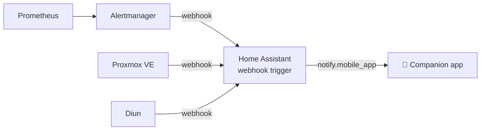

# Homelab alerts → Home Assistant → your phone

[](https://github.com/Vilibera/homelab-alerts-to-home-assistant/releases)
[](LICENSE)

One Home Assistant automation that turns **Prometheus Alertmanager**, **Proxmox VE** and **Diun** webhooks into native push notifications in the Home Assistant companion app. No ntfy, Gotify, Telegram bot or extra container needed.



## Features
- **One webhook, three formats.** The automation detects the payload type. Anything unknown is still forwarded, so no alert gets lost.
- **Severity-aware.** `critical` alerts use a high-priority Android channel and time-sensitive iOS notifications; others are passive.
- **Resolved alerts replace the original.** Notifications are tagged by alert name and instance, so the ✅ "Resolved" message overwrites the 🔴 one instead of piling up.
- **Grouped** into `homelab` and `homelab-updates`. Diun notifications open the image page on Docker Hub when tapped.
- **Local only.** The webhook accepts only LAN requests (`local_only: true`), and its ID is kept in `secrets.yaml`.

## Setup

1. Copy [`homelab_alerts.yaml`](homelab_alerts.yaml) to your HA config folder and include it:
   ```yaml
   # configuration.yaml
   automation homelab: !include homelab_alerts.yaml
   ```
   Keep your existing `automation: !include automations.yaml` line. Labelled includes merge.
2. Add a long random webhook ID to `secrets.yaml`:
   ```yaml
   homelab_alert_webhook_id: "replace-with-a-long-random-string"
   ```
   For example, `openssl rand -hex 24`.
3. Replace `notify.mobile_app_your_phone` with your device's notify service (Developer tools → Actions → search `notify.mobile_app`).
4. Restart Home Assistant (or reload automations).
5. Point your sources to `http://HOME_ASSISTANT:8123/api/webhook/<your-id>`:
   - **Alertmanager:** [`examples/alertmanager.yml`](examples/alertmanager.yml). Use `send_resolved: true`.
   - **Proxmox VE:** Datacenter → Notifications → Add → **Webhook**, method POST, body:
     ```json
     {"source":"proxmox","severity":{{ json severity }},"title":{{ json title }},"message":{{ json message }}}
     ```
   - **Diun:** [`examples/diun.yml`](examples/diun.yml).
6. Test all three formats with [`examples/test.sh`](examples/test.sh):
   ```sh
   ./examples/test.sh http://homeassistant.local:8123 your-webhook-id
   ```

Some starter alert rules (host down, disk full, SMART, stale Borg backup) are in [`examples/alert_rules.yml`](examples/alert_rules.yml).

## Notification format

| Source | Title | Body |
|---|---|---|
| Alertmanager | 🔴 / 🟡 / ℹ️ / ✅ + `annotations.summary` | `annotations.description` or "Resolved." |
| Proxmox | 🔴 / 🟡 Proxmox: *title* | message (first 500 chars) |
| Diun | ⬆️ New version: *container* | image (new/update) – host |
| Unknown | ❔ Homelab notification | raw payload (first 400 chars) |

## Related
- [ha-homelab-server-card](https://github.com/Vilibera/ha-homelab-server-card): a Lovelace dashboard card for the same homelab (servers, backups, restore drills, services).

## License
MIT © Vilius B.
